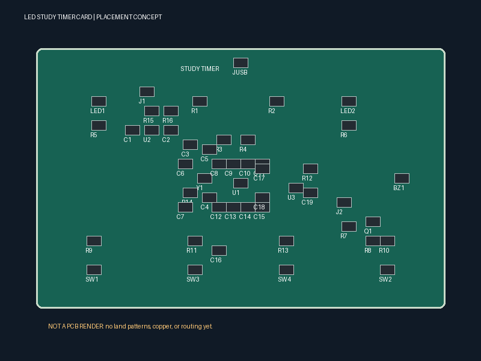

# LED Study Timer Card - Forge Tier 4

Credit-card sized Pomodoro timer helps students focus without phone.

> **Engineering draft — not manufacture-ready or submission-ready.** “Forge
> Tier 4” is the project goal, not an approval or eligibility claim. No native
> KiCad ERC/DRC has run. Do not order this board. See
> [the release checklist](hardware/VALIDATION.md).



*Image is a labeled 800 × 600 placement concept, not a finished PCB render.*

## Features and design intent

- 85 × 54 mm, two-layer credit-card outline; USB-C power and USB 2.0 data.
- RP2040, 12 MHz crystal, AMS1117-3.3 supply, external QSPI flash.
- 0.96-inch SSD1306 I2C OLED on a four-pin 2.54 mm header.
- 25-minute countdown; red focus LED, green completion LED, three buzzer tones.
- START, timer RESET, separate MCU RESET and BOOTSEL controls.
- CircuitPython firmware with deadline-based timing and debounced buttons.
- MIT project source, with separately attributed KiCad library symbols.

## How it works

On power-up the screen shows **STUDY TIMER / Press START**. Press START to
begin a 25:00 countdown and light the red LED. At zero the screen shows
**BREAK! Done!**, red goes off, green comes on, and the passive piezo sounds
three 500 ms tones separated by 500 ms. Timer RESET returns to idle even
during a tone. START is ignored while running or done; reset before restarting.

| Function | RP2040 GPIO / connection |
|---|---|
| OLED SDA / SCL | GP4 / GP5 |
| OLED header J1 | 1=3.3V, 2=GND, 3=SCL, 4=SDA |
| Buzzer base drive | GP10 through 1k to PN2222A; emitter GND |
| START / timer RESET | GP14 / GP15 to GND, external 10k pullups |
| Red / green LED | GP16 / GP17, each through 330 ohms |
| MCU RESET | RUN to GND; separate from timer RESET |
| BOOTSEL | QSPI CS through 1k to GND while booting |

Only use a **3.3 V-compatible OLED**; modules with different pin ordering must
be rewired. The firmware expects a 128 × 64 display at I2C address 0x3C.

## Files and status

| File | Actual content / status |
|---|---|
| `hardware/study-timer.kicad_pro` | KiCad 7-format project draft; native opening not tested |
| `hardware/study-timer.kicad_sch` | Labeled schematic draft using embedded standard symbols; ERC pending |
| `hardware/study-timer.kicad_pcb` | Outline and non-electrical placement envelopes only; NOT routed |
| `hardware/BOM.csv` | Planning allowances, unverified sourcing and footprints |
| `hardware/schematic.pdf` | Connection-review PDF, not a graphical KiCad export |
| `hardware/pcb.png` | Placement concept illustration, not an assembled-board render |
| `hardware/design.json` | Editable pin/net map and proposed placement source |
| `firmware/main.py` | CircuitPython application; host behavior tests pass |
| `hardware/gerber.zip` | **Intentionally absent: no validated manufacturing data exists** |

## Cost planning

Amounts below are **engineering estimates, not current LCSC/JLCPCB prices**.
Blank LCSC IDs mean unverified; Basic-only compliance is not established. The
requested $36.47 total has no supporting quote and is not asserted. The target
is under $40 delivered, but neither that nor a $50 ceiling has been verified.

| Reference | Value | Qty | Unit allowance | Line allowance |
|---|---|---:|---:|---:|
| U1 | RP2040 | 1 | $1.00 | $1.00 |
| JUSB | USB-C USB2 16P | 1 | $0.40 | $0.40 |
| U2 | AMS1117-3.3 | 1 | $0.15 | $0.15 |
| U3 | W25Q32JVSS | 1 | $0.45 | $0.45 |
| J1 | OLED VCC GND SCL SDA | 1 | $0.10 | $0.10 |
| J2 | SWD 3V3 GND CLK DIO | 1 | $0.10 | $0.10 |
| Y1 | 12MHz CL=10pF | 1 | $0.20 | $0.20 |
| Q1 | PN2222A | 1 | $0.10 | $0.10 |
| BZ1 | Passive piezo 3V3 | 1 | $0.30 | $0.30 |
| SW1 | START | 1 | $0.08 | $0.08 |
| SW2 | TIMER RESET | 1 | $0.08 | $0.08 |
| SW3 | MCU RESET | 1 | $0.08 | $0.08 |
| SW4 | BOOTSEL | 1 | $0.08 | $0.08 |
| R1 | 5.1k | 1 | $0.02 | $0.02 |
| R2 | 5.1k | 1 | $0.02 | $0.02 |
| R3 | 27 | 1 | $0.02 | $0.02 |
| R4 | 27 | 1 | $0.02 | $0.02 |
| R5 | 330 | 1 | $0.02 | $0.02 |
| R6 | 330 | 1 | $0.02 | $0.02 |
| R7 | 1k | 1 | $0.02 | $0.02 |
| R8 | 100k | 1 | $0.02 | $0.02 |
| R9 | 10k | 1 | $0.02 | $0.02 |
| R10 | 10k | 1 | $0.02 | $0.02 |
| R11 | 10k | 1 | $0.02 | $0.02 |
| R12 | 10k | 1 | $0.02 | $0.02 |
| R13 | 1k | 1 | $0.02 | $0.02 |
| R14 | 1k | 1 | $0.02 | $0.02 |
| R15 | 4.7k | 1 | $0.02 | $0.02 |
| R16 | 4.7k | 1 | $0.02 | $0.02 |
| LED1 | Red | 1 | $0.03 | $0.03 |
| LED2 | Green | 1 | $0.03 | $0.03 |
| C1 | 10uF | 1 | $0.05 | $0.05 |
| C2 | 22uF tantalum ESR per LDO datasheet | 1 | $0.30 | $0.30 |
| C3 | 4.7uF | 1 | $0.05 | $0.05 |
| C4 | 1uF | 1 | $0.05 | $0.05 |
| C5 | 1uF | 1 | $0.05 | $0.05 |
| C6 | 15pF C0G | 1 | $0.02 | $0.02 |
| C7 | 15pF C0G | 1 | $0.02 | $0.02 |
| C8 | 100nF | 1 | $0.02 | $0.02 |
| C9 | 100nF | 1 | $0.02 | $0.02 |
| C10 | 100nF | 1 | $0.02 | $0.02 |
| C11 | 100nF | 1 | $0.02 | $0.02 |
| C12 | 100nF | 1 | $0.02 | $0.02 |
| C13 | 100nF | 1 | $0.02 | $0.02 |
| C14 | 100nF | 1 | $0.02 | $0.02 |
| C15 | 100nF | 1 | $0.02 | $0.02 |
| C16 | 100nF | 1 | $0.02 | $0.02 |
| C17 | 100nF | 1 | $0.02 | $0.02 |
| C18 | 100nF | 1 | $0.02 | $0.02 |
| C19 | 100nF | 1 | $0.02 | $0.02 |
| OLED_MODULE | SSD1306 I2C 128x64 0.96in; verify pin order | 1 | $2.50 | $2.50 |
| **Parts-only estimate** | **UNVERIFIED** | | | **$6.78** |

PCB fabrication, assembly setup, minimum order quantities, programming,
shipping and tax are **not quoted** and are excluded from this subtotal.
Read [BOM notes](hardware/BOM-NOTES.md) before using these allowances.

## How to order from JLCPCB (after release gates pass)

**Do not upload the current placement study.** These five steps apply only to
a future reviewed, routed, prototype-tested revision:

1. Complete footprint mapping, routing, both GND fills and mechanical checks;
   obtain clean ERC/DRC reports and independently review the prototype.
2. Export real Gerbers for copper, soldermask, silkscreen, paste and outline,
   plus plated/non-plated Excellon drills; inspect in a separate Gerber viewer.
3. Upload the resulting archive and confirm the preview shows an 85 × 54 mm,
   two-layer board with correct holes, outlines, layers and soldermask.
4. For assembly, upload a verified LCSC BOM and centroid file. Check every
   package, rotation, supplier classification and polarized component. Quote
   the OLED/header/buzzer separately if they are hand-assembled.
5. Review delivered price including shipping/tax, approve the assembly preview,
   order a small prototype batch first, and test before any final batch.

## How to flash firmware

The bare RP2040 **cannot run this without external flash and a compatible
CircuitPython build**. This design proposes W25Q32JVSS (4 MB); no matching board
build or physical boot test has been validated. Do not assume a stock Pico UF2
is compatible: flash configuration and board definitions need review.

1. After validated hardware exists, build CircuitPython for the actual flash
   chip, 12 MHz clock and board pin definitions, or verify a compatible build.
2. Hold BOOTSEL, pulse MCU RESET (RUN), then release BOOTSEL. Connect with a
   USB **data** cable; confirm the ROM boot drive appears.
3. Copy the verified CircuitPython UF2 to the boot drive and wait for the
   `CIRCUITPY` drive. Investigate power/USB/flash failures rather than guessing.
4. Install `adafruit_ssd1306.mpy` from the library bundle matching your
   CircuitPython major version into `CIRCUITPY/lib/` (and dependencies specified
   by that bundle, if any).
5. Copy `firmware/main.py` to **`CIRCUITPY/code.py`**. Open the serial console
   to check errors, then test both buttons, LEDs, OLED and buzzer.

## Reproduce and test

```sh
python3 -m venv .venv
.venv/bin/pip install -r tools/requirements.txt
.venv/bin/python tools/build_design.py
python3 -m unittest discover -s tests -v
python3 -m py_compile firmware/main.py
.venv/bin/python tools/validate.py
```

The generator uses the checked-in symbol subset and does not require network
access. The validator checks file structure and host tests only; it explicitly
reports the failed manufacturing release gate. It is not a KiCad replacement.
Read the PDF and schematic side-by-side with `design.json` during review.

## Made with

**KiCad 7 + Arena AI** (KiCad 7 target file format; native KiCad was not available
for validation). Arena AI generated the design draft, documentation, code and
host tests. AI use is declared transparently; no claim about Forge's AI policy
or absence of penalties is made. Hardware engineering and physical testing
remain required. Python, Pillow and ReportLab generate review artifacts.

## License and author

Project code and original documentation: [MIT License](LICENSE). Standard
KiCad symbols retain their [upstream license](hardware/SYMBOL-LICENSE.md).

**Author: Harsh, 14, Jaipur, India** (author information supplied by requester).
